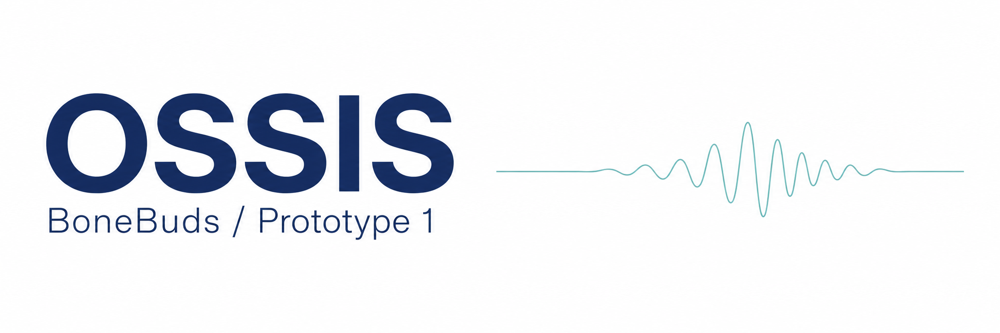
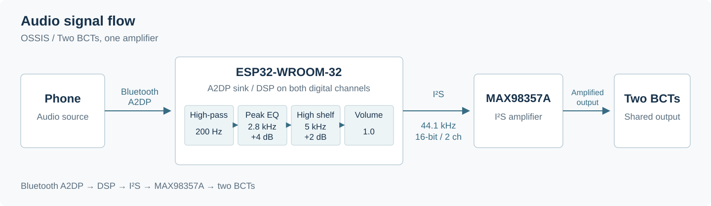
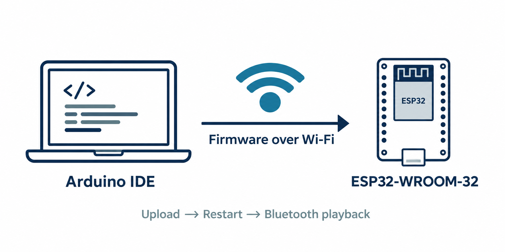
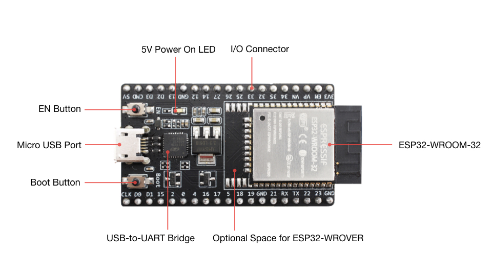
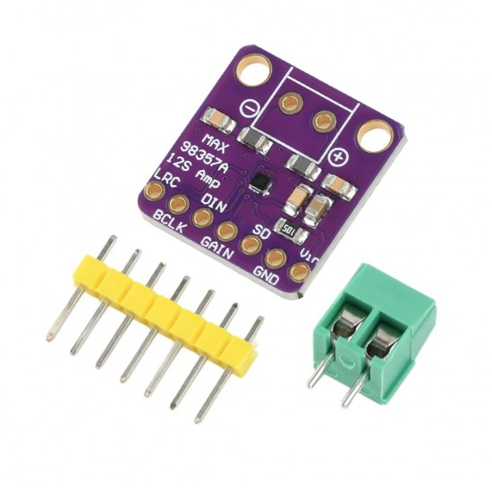
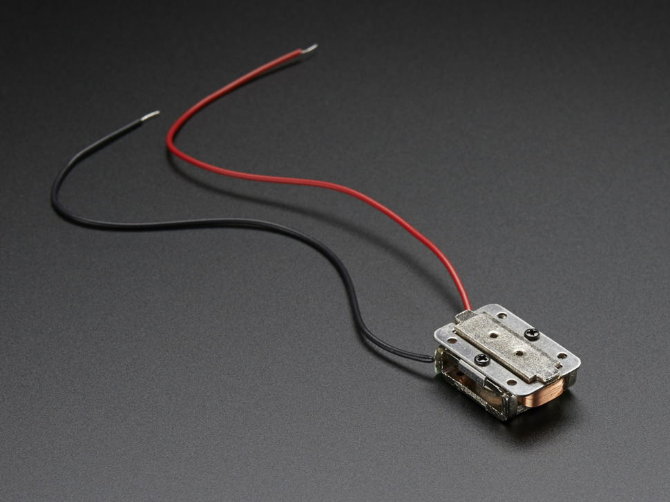
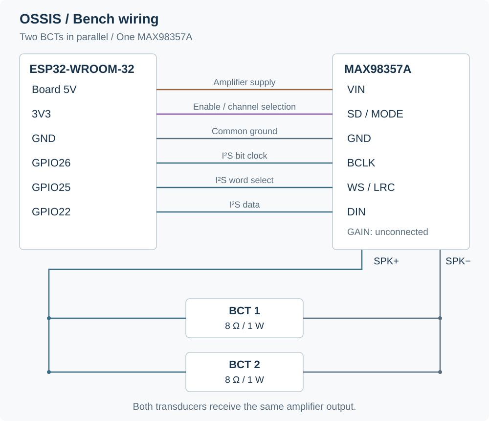

# BoneBuds / OSSIS



We’re building OSSIS, our first BoneBuds prototype, for clean Bluetooth audio playback through a bone-conduction transducer.

We have verified Bluetooth playback and wireless OTA updates. Our latest phone test drove two BCTs in parallel from one MAX98357A, producing clear, loud audio without audible noise. Independent stereo is next; CAD design work continues in parallel.


[Current firmware](code/ossis/main/main.ino) · [Upload guide](code/README.md) · [Bench setup](docs/test-setup.md) · [Test records](docs/test-results.md)

## Current status

| Test | Scope | Status |
| --- | --- | --- |
| **T01: Bluetooth A2DP playback** | Bluetooth A2DP → DSP → I²S → amplifier | **PASSED** · 24 October 2026 |
| **T02: Wireless OTA** | Wireless firmware upload with separate audio and update modes | **PASSED** · 29 October 2026 |
| **T03: Stereo playback** | Two MAX98357A amplifiers and two BCTs | **NEXT** · Waiting for the second amplifier |

## Audio architecture

We use the ESP32 to receive Bluetooth Classic A2DP audio, process both digital channels and send the result over I²S. One MAX98357A drives two bone-conduction transducers (BCTs) from a shared mono output.

[](images/diagrams/ossis-audio-path.svg)

| DSP stage | Configured setting | Purpose |
| --- | --- | --- |
| High-pass | 200 Hz | Attenuate low-frequency content |
| Peaking EQ | 2.8 kHz, +4 dB | Emphasize the presence region |
| High shelf | 5 kHz, +2 dB | Adjust high-frequency balance |

The configured I²S format is **44.1 kHz, 16-bit, two digital channels**.

Both BCTs receive the same amplifier output. Independent left/right playback is the next test. [DSP settings](code/ossis/tests/T01_wroom_bt_a2dp/README.md#signal-path-and-dsp).

## T01: Bluetooth A2DP playback

We verified Bluetooth Classic A2DP streaming through the ESP32-WROOM-32 and MAX98357A on **24 October**.

Our **29 October** phone test used two 8 Ω BCTs in parallel on one amplifier. Audio was loud and clear at the contact areas just in front of each ear, while surrounding sounds remained audible. We did not need maximum volume.

There was no noticeable sound leakage at normal listening volume and only very faint leakage at maximum. Laptop streaming produced slight noise and intermittent breakup, so we will use a phone as the reference source for future tests.

[](https://youtube.com/shorts/Wacn75VJihI)

[T01 sketch](code/ossis/tests/T01_wroom_bt_a2dp/T01_wroom_bt_a2dp.ino) · [Reproduce the test](code/ossis/tests/T01_wroom_bt_a2dp/README.md) · [Recorded observations](docs/test-results.md#t01-bluetooth-a2dp-playback)

## T02: Wireless OTA

We use OTA to upload firmware from Arduino IDE over Wi-Fi after the initial USB installation. This lets us update the firmware without a USB data connection. Bluetooth audio and Wi-Fi OTA run on separate boots.



- **Bluetooth mode:** pair within the initial **20-second** connection window. Once connected, audio mode remains active. Losing that connection for **3 seconds** triggers OTA; pausing music while still connected does not.
- **OTA mode:** the ESP32 runs a Wi-Fi access point and ArduinoOTA on **port 3232**, with no automatic timeout. The saved mode survives a reset.
- **Return to playback:** a completed update saves Bluetooth mode for the next boot. The **Start Bluetooth** button at `http://192.168.4.1` also saves that mode and restarts the board. The web page controls the mode; it is not a firmware upload form.

| Demonstration | Arduino IDE record |
| :---: | :---: |
| [](https://youtu.be/clWIIejxp3k) | [](images/tests/T02/ota-upload-arduino-ide.png) |
| Wireless firmware update | **OTA upload in progress** |

[T02 sketch](code/ossis/tests/T02_mono_ota/T02_mono_ota.ino) · [Mode flowchart and upload procedure](code/ossis/tests/T02_mono_ota/README.md) · [Test record](docs/test-results.md#t02-wireless-ota)

## Bill of materials

Our current two-BCT, single-amplifier setup:

| Reference photo | Part and use | Qty | Unit cost | Total |
| :---: | --- | :---: | ---: | ---: |
|  | [ESP32-WROOM-32 development board](https://docs.espressif.com/projects/esp-idf/en/v4.4/esp32/hw-reference/esp32/get-started-devkitc.html)<br>38 pins; Bluetooth, DSP, I²S and Wi-Fi OTA | 1 | ₹400 | ₹400 |
|  | [MAX98357A amplifier](https://www.hubtronics.in/max98357a-stereo-amplifier-module)<br>I²S input, mono Class-D output | 1 | ₹134 est. | ₹134 |
|  | [Adafruit BCT, product 1674](https://www.adafruit.com/product/1674)<br>8 Ω, 1 W RMS each | 2 | ₹700 | ₹1,400 |
| | **Estimated total** | | | **₹1,934** |

### Wiring



[Connection table](docs/test-setup.md)

## Firmware and repository

> **Main firmware:** [main.ino](code/ossis/main/main.ino) holds our latest tested build, currently **T02 (Bluetooth + OTA)**.

```text
code/
  README.md                         Build and upload guide
  ossis/
    main/main.ino                   Latest tested build (T02)
    tests/T01_wroom_bt_a2dp/         Bluetooth playback baseline
    tests/T02_mono_ota/              Wireless OTA experiment
docs/                               Setup, results and development history
images/                             Diagrams, visual assets and test evidence
```

[Documentation index](docs/README.md) · [Test results](docs/test-results.md) · [Development log](docs/development-log.md)

## Next work

| Work | State | Next action |
| --- | --- | --- |
| **T03: Stereo playback** | Next | Obtain the second amplifier, configure independent left/right channels and test two BCTs |
| **CAD design** | In progress | Continue mechanical design alongside audio testing; no design files are included in this revision |
