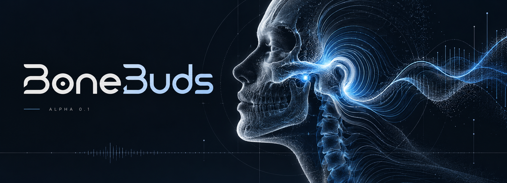
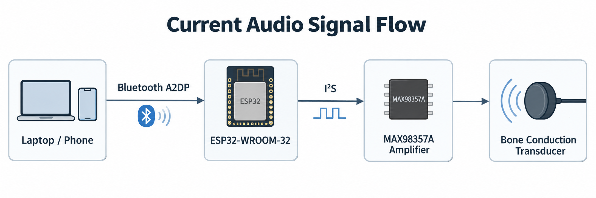
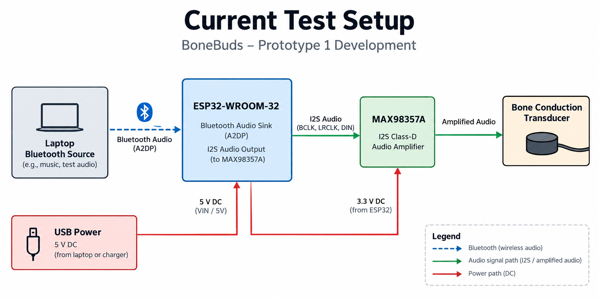
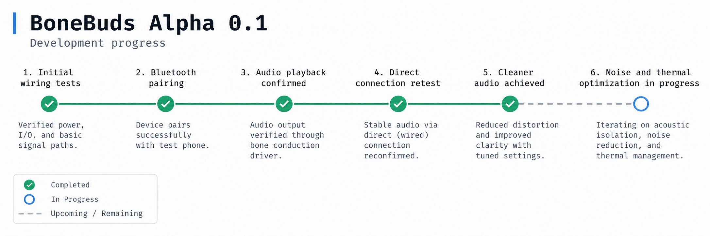

  

<h1 align="center">BoneBuds</h1>

<strong>ALPHA 0.1 / BASELINE AUDIO VALIDATION</strong>

One verified audio test · Prototype 1 in development

  <a href="#demo">Demo</a> ·
  <a href="#signal">Audio path</a> ·
  <a href="#setup">Test setup</a> ·
  <a href="#results">Results</a> ·
  <a href="#progress">Progress</a> ·
  <a href="#next">Next tests</a>

BoneBuds explores bone-conduction audio for a future hearing-assistance device. We are starting with small, repeatable hardware tests before putting together Prototype 1. **Alpha 0.1 is the testing stage, not a finished prototype.**

---

## 01 / Bluetooth audio playback

**T01** &nbsp; `ESP32-WROOM-32` &nbsp; `Bluetooth A2DP` &nbsp; `Single BCT`  
**24 October 2026** &nbsp; · &nbsp; **Playback verified**

### [Watch the T01 test on YouTube ↗](https://youtube.com/shorts/Wacn75VJihI)

A laptop streamed music to an ESP32-WROOM-32 over Bluetooth. Audio passed through I²S to a MAX98357A amplifier and played through one bone-conduction transducer.

The first working setup had substantial noise. After correcting the direct connections, playback was noticeably cleaner.

**[View the verified T01 code](code/alpha-0.1/tests/T01_wroom_bt_a2dp/T01_wroom_bt_a2dp.ino)** · **[Reproduce this test](code/alpha-0.1/tests/T01_wroom_bt_a2dp/README.md)**

---

## 02 / Audio signal flow

  

**Laptop → Bluetooth A2DP → ESP32-WROOM-32 → I²S → MAX98357A → BCT**

- **A2DP** carries audio from the laptop to the ESP32.
- **I²S** carries digital audio from the ESP32 to the amplifier.
- **MAX98357A** drives the bone-conduction transducer.

*The verified T01 source was a laptop. Phone playback shown in the original graphic was not part of this test.*

---

## 03 / Bench setup

  

| Part | Used in T01 |
| :--- | :--- |
| Controller | ESP32-WROOM-32, 38-pin board |
| Amplifier | MAX98357A I²S breakout |
| Output | One passive bone-conduction transducer |
| Source / power | Laptop over Bluetooth A2DP / USB-powered ESP32 |

**Pin connections**

| Connection | MAX98357A |
| :--- | :--- |
| GPIO26 | BCLK |
| GPIO25 | LRC / WS |
| GPIO22 | DIN |
| Board 5V | VIN |
| GND | GND |
| 3V3 | SD |
| No connection | GAIN |
| BCT leads | SPK+ and SPK− |

> [!IMPORTANT]
> Use the table as the wiring reference. In the supplied setup image, the power paths are simplified: **5V goes to VIN; 3V3 goes separately to SD**. The BCT connects across **SPK+ and SPK−**, not to GND.

[Full wiring and test setup](docs/test-setup.md)

---

## 04 / T01 results

| Check | Observation |
| :--- | :--- |
| Bluetooth pairing and streaming | **Passed** with laptop |
| Audio output | **Confirmed** through one BCT |
| Direct-connection retest | Noticeably cleaner playback |
| Current sound quality | Working, with a slight quality limitation remaining |
| Idle vibration / heating | Not noticed in the latest short test |
| Sustained thermal and acoustic performance | **Not measured** |

**What changed:** Early tests had inconsistent connections, unwanted idle vibration, noise and rapid heating. Correcting the physical connections improved playback. The cause of every earlier symptom has not been isolated, and a short retest is not a thermal safety assessment.

[Detailed T01 test results](docs/test-results.md)

---

## 05 / Development notes

  

*This is a snapshot of early testing, not a live tracker. T01 used a laptop; cleaner playback followed corrected connections, not a measured DSP improvement.*

| Date | Progress |
| :--- | :--- |
| Earlier tests | S3 audio experiments and wiring checks; end-to-end playback not verified |
| **24 Oct 2026** | WROOM Bluetooth A2DP playback through one BCT confirmed |
| **24 Oct 2026** | Direct connection corrected; much cleaner audio observed |
| **25 Oct 2026** | Latest short test reported no unwanted vibration or noticeable heating; minor audio-quality work remains |

The full log records unsuccessful attempts, suspected causes, fixes and what still needs testing. Future experiments will be added there without changing the T01 record.

**[Read the dated development log](docs/development-log.md)**

---

## 06 / Next on the bench

These are **planned experiments**, not completed tests. New test IDs will be assigned when results are verified.

- **Two BCTs:** Evaluate independent amplifier channels and playback on ESP32-WROOM-32 and ESP32-S3.
- **ESP32-S3 audio:** Test local Wi-Fi audio playback and DSP settings for improved sound quality.
- **Bluetooth options:** Assess a dedicated Bluetooth audio module for the S3-based setup.
- **Portable Prototype 1:** Work out battery, power architecture, component layout and enclosure requirements.

*ESP32-S3 does not support Bluetooth Classic A2DP natively; its current playback route is the local audio server/player.*

---

## Source and records

| Open | Find |
| :--- | :--- |
| [T01 firmware](code/alpha-0.1/tests/T01_wroom_bt_a2dp/T01_wroom_bt_a2dp.ino) | Verified WROOM Bluetooth sketch |
| [T01 README](code/alpha-0.1/tests/T01_wroom_bt_a2dp/README.md) | Libraries, upload steps and test procedure |
| [Test setup](docs/test-setup.md) | Wiring and hardware notes |
| [Test results](docs/test-results.md) | Observations, evidence and limitations |
| [Development log](docs/development-log.md) | Dated tests, issues and changes |

**Bench testing only.** Keep the transducer off the body until suitable output-level and thermal checks are complete. Disconnect power before rewiring. Stop testing if strong vibration or heating returns.
