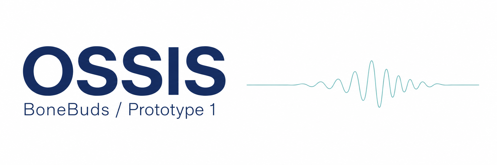
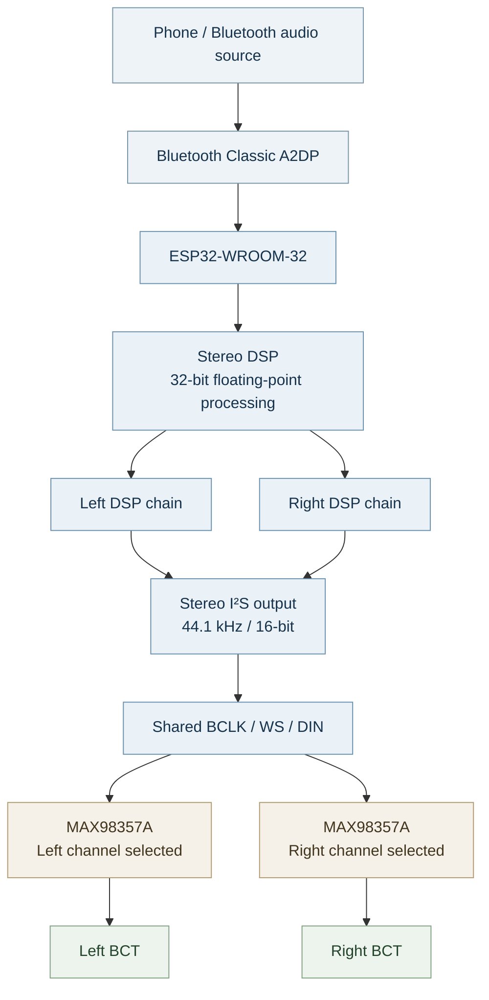
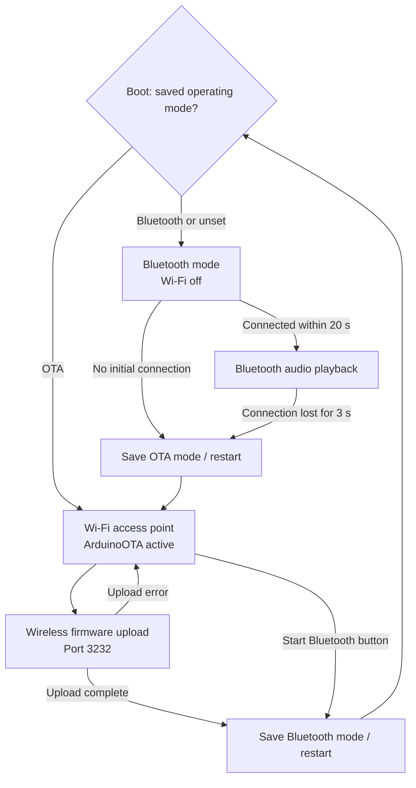
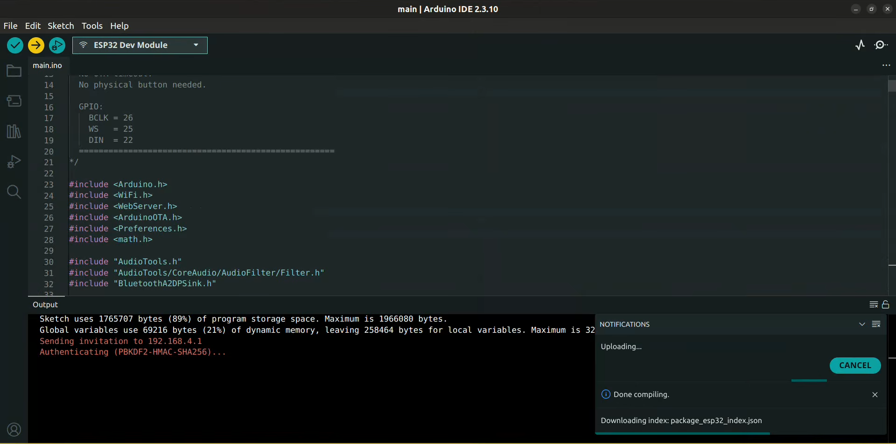
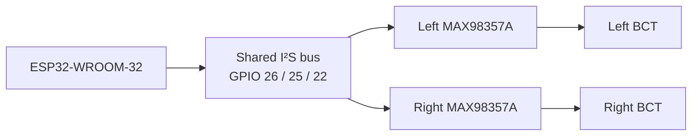
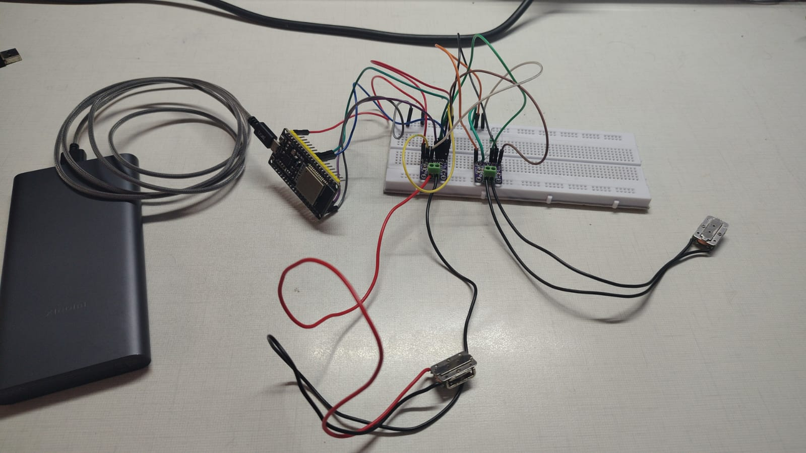
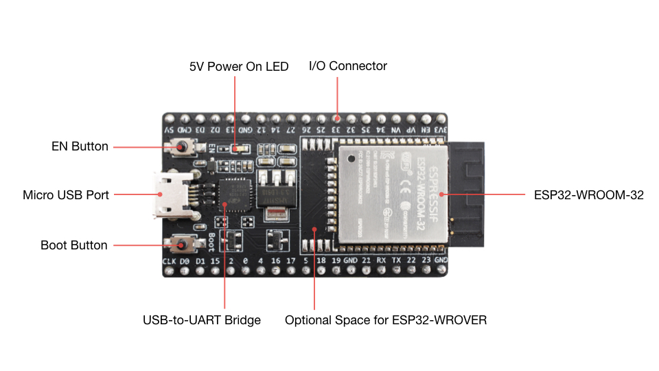
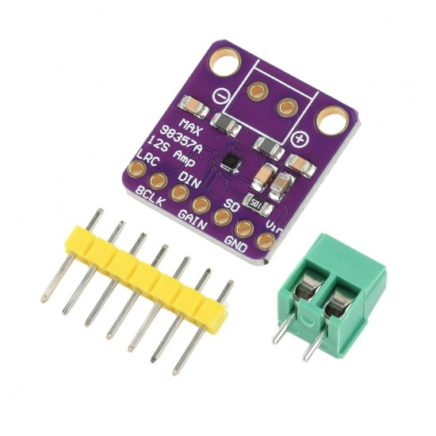
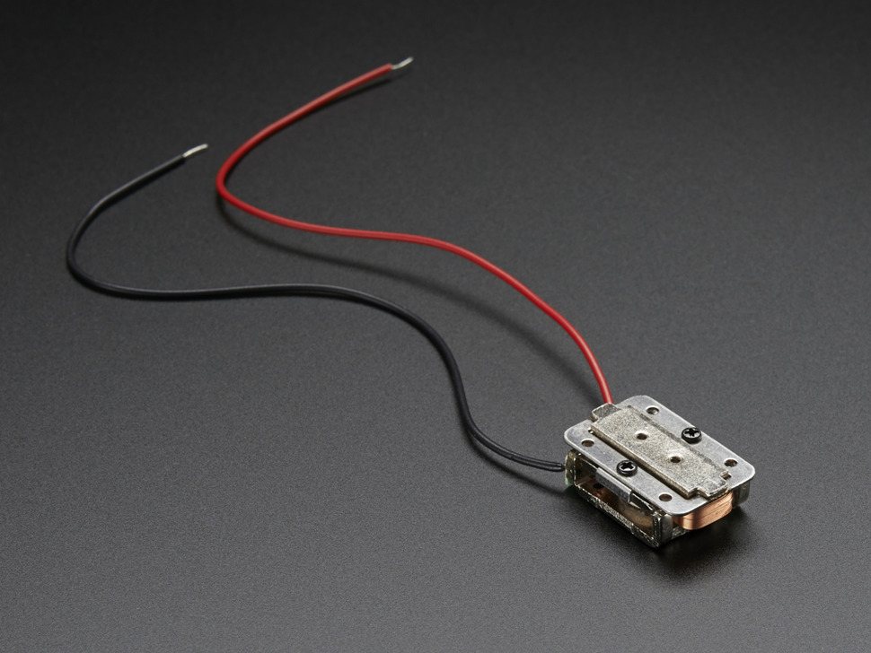

# BoneBuds / OSSIS



We’re building OSSIS, the first BoneBuds prototype: a Bluetooth audio system that delivers sound through bone-conduction transducers.

We have verified Bluetooth playback, wireless firmware updates and independent left/right stereo playback. Our current bench prototype uses an ESP32-WROOM-32, two MAX98357A amplifiers and two separate bone-conduction transducers (BCTs).

The next stage is moving from breadboard testing towards a compact perfboard assembly, battery-powered operation and a wearable product design.


[Current firmware](code/ossis/main/main.ino) · [Upload guide](code/README.md) · [Bench setup](docs/test-setup.md) · [Test records](docs/test-results.md) · [Development log](docs/development-log.md)

## Current status

| Test | Scope | Status |
| --- | --- | --- |
| **T01: Bluetooth A2DP playback** | Bluetooth audio reception, DSP and I²S amplification | **PASSED** · 24 October 2026 |
| **T02: Wireless OTA** | Firmware uploads over Wi-Fi using ArduinoOTA | **PASSED** · 29 October 2026 |
| **T03: Independent stereo** | Two MAX98357A amplifiers and two separate BCTs | **PASSED** |

## Audio architecture

The ESP32 receives Bluetooth Classic A2DP audio in two digital channels. Each channel passes through its own independent DSP processing chain before reaching the stereo I²S output.

Both MAX98357A amplifiers receive the shared I²S clock and data connections. Their SD_MODE configurations select different channels, allowing each amplifier to drive its own transducer.



### DSP configuration

The current stereo firmware uses separate `BoneChannelDSP` instances for left and right audio processing.

| DSP stage | Configured setting | Purpose |
| --- | --- | --- |
| Pre-gain | -4.5 dB | Creates headroom before EQ boosts |
| High-pass | 180 Hz, Q = 0.7071 | Attenuates low-frequency content |
| Peaking EQ | 2.8 kHz, +4 dB, 0.8-octave bandwidth | Emphasizes the presence region |
| High shelf | 5.5 kHz, +2.5 dB, slope = 1.0 | Adjusts high-frequency balance |
| Output limiter | Soft-knee above 90% full scale | Reduces harsh peak clipping |
| Master volume | 1.0 | Output scaling |

The DSP chain uses 32-bit floating-point calculations, followed by a soft-knee limiter and a signed 16-bit safety clamp.

The configured I²S format is **44.1 kHz, 16-bit, two channels**. Hardware APLL is enabled in the current firmware.

[Current DSP implementation](code/ossis/main/main.ino) · [T03 test documentation](code/ossis/tests/T03_independent_stereo/README.md)

## T01: Bluetooth A2DP playback

**PASSED · 24 October 2026.** We verified Bluetooth Classic A2DP streaming through the ESP32-WROOM-32, MAX98357A and one bone-conduction transducer.

[Verified T01 sketch](code/ossis/tests/T01_wroom_bt_a2dp/T01_wroom_bt_a2dp.ino) · [Reproduce the test](code/ossis/tests/T01_wroom_bt_a2dp/README.md) · [Bench wiring](docs/test-setup.md)

### 29 October: Shared-amplifier playback

We subsequently tested two Adafruit 8 Ω, 1 W BCTs connected in parallel to one MAX98357A amplifier, using a phone as the Bluetooth source.

Audio was clear and loud at the contact points just in front of each ear, while surrounding sounds remained audible. Maximum volume was unnecessary.

There was no noticeable sound leakage at normal listening volume and only very faint leakage at maximum volume when listening closely.

Laptop streaming produced slight noise and intermittent breakup, so we selected a phone as our reference source for subsequent testing.

[](https://youtube.com/shorts/Wacn75VJihI)

[Recorded observations](docs/test-results.md#t01-bluetooth-a2dp-playback)

## T02: Wireless OTA

**PASSED · 29 October 2026.** We verified wireless firmware uploads on the ESP32-WROOM-32 using ArduinoOTA over Wi-Fi.

OTA allows us to upload firmware through Arduino IDE without a USB data connection after the initial USB installation.

Bluetooth playback and OTA operate on separate boots. The firmware saves the operating mode using Preferences before restarting.

### Operating modes



- **Bluetooth mode:** Pair within the initial 20-second connection window. Once connected, audio mode remains active.
- **Disconnection:** Losing an established Bluetooth connection for 3 seconds triggers OTA mode. Pausing music while still connected does not.
- **OTA mode:** The ESP32 runs a Wi-Fi access point and ArduinoOTA on port 3232. There is no automatic OTA timeout.
- **Return to playback:** A completed firmware update saves Bluetooth mode for the next boot.
- **Manual return:** The **Start Bluetooth** button at `http://192.168.4.1` saves Bluetooth mode and restarts the board.

<details>
<summary>Detailed OTA procedure and operating notes</summary>

1. Install the firmware over USB initially.
2. Leave Bluetooth unconnected for 20 seconds, or disconnect an established connection and wait 3 seconds.
3. Connect your computer to the ESP32 Wi-Fi access point.
4. Open `http://192.168.4.1` to check OTA mode.
5. Select the ESP32 network port in Arduino IDE and upload the firmware.
6. Wait for the update to complete and the board to restart.
7. Reconnect to the Bluetooth audio device.

The web page controls the operating mode; it is not a firmware upload form.

The saved mode survives a reset. A reset alone does not exit OTA mode.

</details>

| Demonstration | Arduino IDE record |
| :---: | :---: |
| [](https://youtu.be/clWIIejxp3k) | [](images/tests/T02/ota-upload-arduino-ide.png) |
| Wireless firmware update | **OTA upload in progress** |

[T02 sketch](code/ossis/tests/T02_mono_ota/T02_mono_ota.ino) · [Mode flowchart and upload procedure](code/ossis/tests/T02_mono_ota/README.md) · [Test record](docs/test-results.md#t02-wireless-ota)

## T03: Independent Stereo Playback

**PASSED.** We successfully verified independent left and right audio playback using two MAX98357A amplifier modules and two separate bone-conduction transducers.

Each amplifier receives the same I²S clock and data signals but selects a different digital channel through its SD_MODE configuration.

The left amplifier drives the left BCT, and the right amplifier drives the right BCT.

### Hardware architecture



### Channel selection

The two amplifiers use different SD_MODE configurations:

| Amplifier | SD_MODE connection | Selected channel |
| --- | --- | --- |
| Left | Direct +5V connection | Left |
| Right | 1 kΩ / 230 Ω resistor divider | Right |

The tested right-channel resistor arrangement uses:

- 1 kΩ (Brown - Black - Red - Gold) from +5V to SD_MODE.
- 230 Ω (Red - Orange - Brown - Gold) from SD_MODE to GND.

> [!WARNING]
> Keep the speaker outputs of the two MAX98357A amplifiers electrically separate. Each amplifier drives only its own BCT.

### Hardware evidence

The photograph below documents our actual T03 stereo bench configuration.

[](images/tests/T03/t03-stereo-hardware-setup.jpg)

*OSSIS T03: Independent left and right audio playback using two amplifier modules.*

### Verification results

| Check | Result |
| --- | --- |
| Bluetooth A2DP connection | **PASSED** |
| Left-channel playback | **PASSED** |
| Right-channel playback | **PASSED** |
| Independent left/right output | **PASSED** |
| Both amplifiers operating together | **PASSED** |
| Separate BCT outputs | **PASSED** |

We verified independent channel playback using stereo test audio.

[T03 test sketch](code/ossis/tests/T03_independent_stereo/T03_independent_stereo.ino) · [T03 test procedure](code/ossis/tests/T03_independent_stereo/README.md) · [T03 test record](docs/test-results.md#t03-independent-stereo-playback)

> [!NOTE]
> T03 is now the current main firmware. The T02 OTA functionality remains available in its separate test sketch and has not yet been integrated into the current stereo firmware.

## Bill of Materials

Our current T03 bench prototype uses one ESP32 development board, two amplifier modules and two bone-conduction transducers.

| Reference photo | Part and use | Qty | Unit cost | Total |
| :---: | --- | :---: | ---: | ---: |
|  | [ESP32-WROOM-32 development board](https://docs.espressif.com/projects/esp-idf/en/v4.4/esp32/hw-reference/esp32/get-started-devkitc.html)<br>38 pins; Bluetooth, DSP, I²S and Wi-Fi | 1 | ₹400 | ₹400 |
|  | [MAX98357A amplifier](https://www.hubtronics.in/max98357a-stereo-amplifier-module)<br>I²S input, mono Class-D output | 2 | ₹200 | ₹400 |
|  | [Adafruit BCT, product 1674](https://www.adafruit.com/product/1674)<br>8 Ω, 1 W RMS each | 2 | ₹700 | ₹1,400 |
| | **Estimated hardware total** | | | **₹2,200** |

The 1 kΩ and 230 Ω resistors used for right-channel selection are existing components and are not included in the estimated total.

### Wiring

The current bench wiring uses shared I²S connections and independent amplifier outputs.

[Connection table and SD_MODE wiring](docs/test-setup.md)

[Physical T03 hardware setup](images/tests/T03/t03-stereo-hardware-setup.jpg)

The older [shared-amplifier wiring diagram](images/diagrams/ossis-wiring.svg) documents the earlier two-BCT mono configuration, not the current independent stereo setup. The original [T01 wiring diagram](images/diagrams/t01-wiring.svg) is retained as a historical reference.

## Firmware and repository

> [!IMPORTANT]
> **Current firmware:** [main.ino](code/ossis/main/main.ino) contains the latest working **T03 independent stereo implementation**. It currently does not include the T02 wireless OTA functionality.

```text
code/
  README.md
  ossis/
    main/
      main.ino                       Current T03 stereo firmware
    tests/
      T01_wroom_bt_a2dp/
        T01_wroom_bt_a2dp.ino        Bluetooth playback baseline
        README.md
      T02_mono_ota/
        T02_mono_ota.ino             Wireless OTA experiment
        README.md
      T03_independent_stereo/
        T03_independent_stereo.ino   Independent stereo test
        README.md

docs/
  README.md                          Documentation index
  test-setup.md                      Current hardware connections
  test-results.md                    Verified test records
  development-log.md                 Engineering history

images/
  hero/                              Project masthead
  components/                        Hardware reference photos
  diagrams/                          Architecture and wiring diagrams
  tests/
    T02/                             OTA test evidence
    T03/                             Stereo hardware evidence
```

[Documentation index](docs/README.md) · [Test results](docs/test-results.md) · [Development log](docs/development-log.md) · [Firmware guide](code/README.md)

## Next work

With independent stereo playback verified, our next objective is to move towards a more compact, battery-powered and wearable prototype.

| Work | State | Next action |
| --- | --- | --- |
| **Perfboard prototype** | NEXT | Replace temporary breadboard connections with a more stable assembly |
| **Battery integration** | Planned | Develop portable power and test battery-powered playback and runtime |
| **Product concept** | Planned | Explore product form, wearable arrangement and industrial design ideas |
| **3D mechanical design** | Not started | Develop the enclosure and mechanical assembly |
| **Final testing** | Planned | Validate audio quality, reliability, power consumption and thermal behaviour |
| **System optimization** | Planned | Refine firmware, hardware and overall listening experience |

[Development log](docs/development-log.md) · [Test results](docs/test-results.md) · [Bench setup](docs/test-setup.md)
