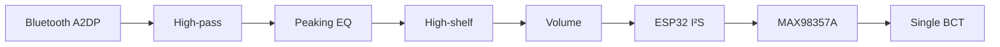

# OSSIS / Firmware

BoneBuds' first experimental bone-conduction audio system. This folder keeps tested firmware separate from work in progress.

## Bench tests

| ID | Experiment | Status | Record |
| :-- | :-- | :-- | :-- |
| **T01** | Bluetooth A2DP → one bone-conduction transducer | **Playback verified**, 24 Oct 2026 | [Sketch and setup](alpha-0.1/tests/T01_wroom_bt_a2dp/README.md) |
| **T02** | Wi-Fi OTA firmware updates | **Under test**; successful update not yet verified | Local development sketch, not yet committed |

T01 is an unchanged archive of [`prototype1.ino`](prototype1/prototype1.ino). The existing `alpha-0.1/` directory is a legacy path, retained so historical links continue to work.

## Audio path

| DSP setting | Firmware value |
| :-- | :-- |
| High-pass | 200 Hz |
| Peaking EQ | 2.8 kHz, +4 dB |
| High-shelf | 5 kHz, +2 dB |
| Output | 44.1 kHz, 16-bit; volume 1.0 |
| I²S pins | BCLK **26**, WS **25**, DIN **22** |

These are **configured EQ stages**, not measured improvements in clarity or noise. The MAX98357A is a mono amplifier; the two-channel I²S setting alone does not verify stereo output or mono mixing.

## T02 / OTA changes

T02 retains the T01 audio path and adds ArduinoOTA, a Wi-Fi access point, a simple local control page, and saved boot-mode selection. Bluetooth audio and Wi-Fi OTA run in **separate modes**; switching modes restarts the ESP32. OTA has no waiting timeout once active.

Authentication, repeated-start stability and a complete wireless firmware update still need validation. **Keep upload passwords out of public commits.**

## Test records

Add firmware only with its wiring, dependencies, procedure and observed result. Update [test results](../docs/test-results.md), [setup notes](../docs/test-setup.md) and the [development log](../docs/development-log.md). Do not label an experiment verified until hardware testing confirms it.
