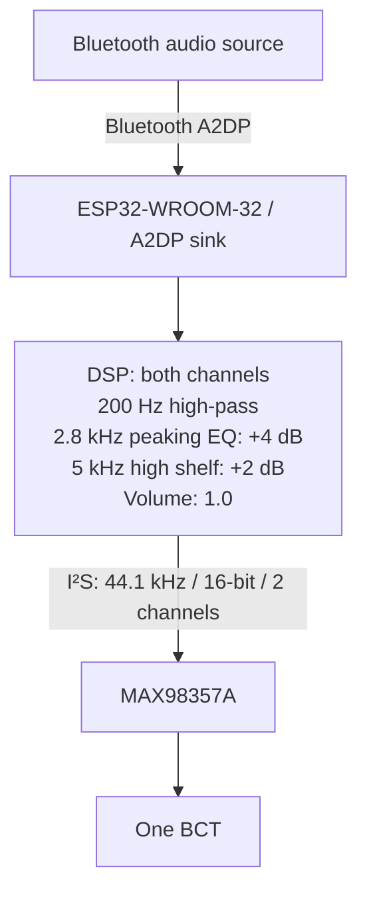

# T01: Bluetooth A2DP playback

**PASSED · 24 October 2026.** We verified A2DP streaming through an ESP32-WROOM-32, MAX98357A and one BCT.

[Test sketch](T01_wroom_bt_a2dp.ino) · [Main firmware](../../main/main.ino) · [Bench wiring](../../../../docs/test-setup.md)

## Signal path and DSP

| Setting | Value in the sketch |
| --- | --- |
| High-pass | `HighPassFilter<float>`, 200 Hz |
| Peaking EQ | Custom coefficients → `BiQuadDF2<float>`; 2,800 Hz, +4 dB; `PEAK_BW = 0.8` |
| High shelf | `HighShelfFilter<float>`, 5,000 Hz, +2 dB |
| Software volume | `VolumeStream`: 1.0; A2DP volume: 127 |
| I²S output | 44,100 Hz, 16-bit, two channels; buffer size 512, count 8 |
| I²S pins | BCLK 26, WS 25, data 22 |

We apply the filters independently to both digital channels. `PEAK_BW = 0.8` is labelled in octaves in the source; amplifier channel selection depends on SD/MODE wiring, with no explicit software downmix.

## Reproduce

1. With power disconnected, wire the ESP32-WROOM-32, MAX98357A and one BCT using the [T01 wiring diagram](../../../../images/diagrams/t01-wiring.svg).
2. Open [T01_wroom_bt_a2dp.ino](T01_wroom_bt_a2dp.ino) to reproduce this baseline. Use the [firmware guide](../../../README.md#upload-the-current-firmware) for libraries and board settings, then verify and upload.
3. Open Serial Monitor at **115200 baud**. Select **ESP32 Bone Speaker** as the phone’s Bluetooth audio output.
4. Start at low source volume: the sketch initializes its software volume controls at full scale. Play a known clip on the bench and check idle behaviour, playback and heating.

T01 has no OTA mode. Use [main.ino](../../main/main.ino) for the latest tested build.

## Evidence and result

[T01 demonstration](https://youtube.com/shorts/Wacn75VJihI). We verified A2DP playback and improved the physical connections. Our latest phone test used two BCTs on one amplifier and produced clear, loud audio. [Test results](../../../../docs/test-results.md#t01-bluetooth-a2dp-playback).
