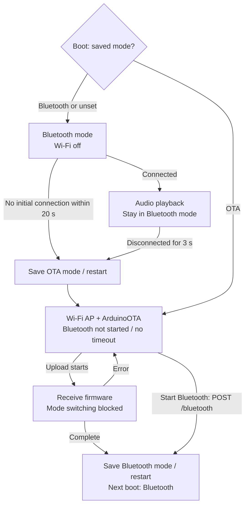
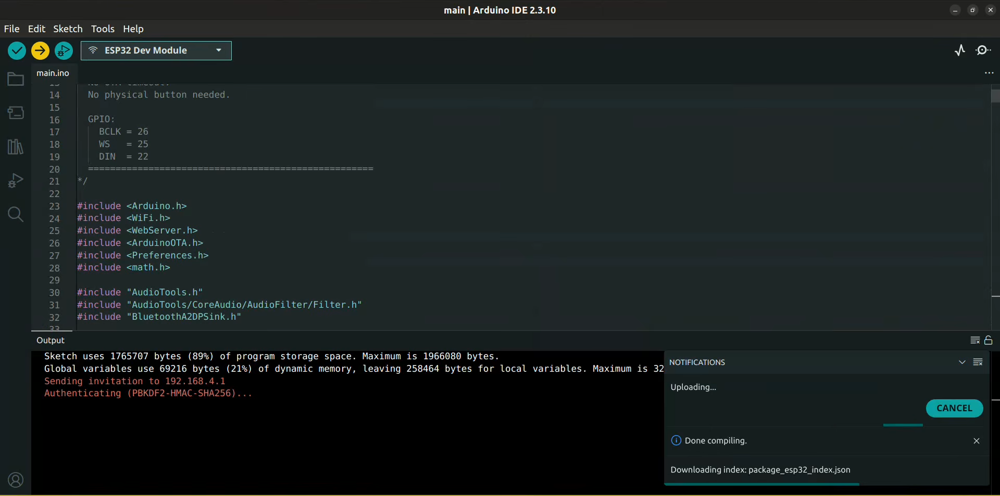

# T02: Wireless OTA

**PASSED · 29 October 2026.** We verified wireless firmware uploads on the ESP32-WROOM-32.

[Test sketch](T02_mono_ota.ino) · [Main firmware](../../main/main.ino) · [Bench wiring](../../../../docs/test-setup.md)

## Operating modes

We run Bluetooth audio and Wi-Fi OTA on separate boots. The firmware saves `bootmode` in Preferences before restarting, so a normal reset keeps the selected mode. Bluetooth is the default when no valid mode is stored.

The 20-second window starts after Bluetooth initialization on each Bluetooth-mode boot. The 3-second delay follows loss of an established connection; pausing music while still connected does not enter OTA. OTA accepts one Wi-Fi client and stays active until an update or the web button returns it to Bluetooth. During an upload, the button returns HTTP 409.

## OTA procedure

1. **Install over USB first.** Open [main.ino](../../main/main.ino) for the current build, or [T02_mono_ota.ino](T02_mono_ota.ino) to reproduce this test. Follow the [firmware guide](../../../README.md#upload-the-current-firmware), including the OTA-capable partition requirement.
2. **Enter OTA mode.** Leave Bluetooth unconnected for 20 seconds after startup, or disconnect an established Bluetooth connection and wait 3 seconds. The ESP32 saves OTA mode and restarts. Use Serial Monitor at **115200 baud** to check the active mode and access-point address.
3. **Join the ESP32 Wi-Fi access point.** Its name is configured by `OTA_SSID`. Use the configured Wi-Fi and upload passwords. `OTA_WIFI_PASS` and `OTA_UPLOAD_PASS` are separate credentials; their hardcoded values require review before publication.
4. **Check the status page.** Open `http://192.168.4.1`. This page reports OTA status and offers **Start Bluetooth**; it does not upload firmware.
5. **Upload from Arduino IDE.** Select the ESP32 network port, currently named `bonebuds-test01`, at `192.168.4.1`. Keep the board and partition settings consistent with the USB installation. Upload and enter the OTA upload password when prompted. ArduinoOTA listens on **port 3232**. If discovery fails, check that the computer is on the ESP32 access point; the ESP32 core's `espota.py` can also target its IP directly.
6. **Confirm completion.** Wait for the uploader to report success and the ESP32 to reboot. The completion callback saves Bluetooth mode. Reconnect to **ESP32 Bone Speaker** within 20 seconds of Bluetooth startup; otherwise it enters OTA again. Verify playback after the update.

To leave OTA without uploading, use **Start Bluetooth** on the status page. Resetting alone keeps the stored OTA mode. Keep power connected throughout the transfer.

## Evidence

[OTA demonstration](https://youtu.be/clWIIejxp3k).

**OTA upload in progress** · Arduino IDE 2.3.10.

We completed the wireless update and returned to Bluetooth playback. [Test results](../../../../docs/test-results.md#t02-wireless-ota) · [Source notes](../../../README.md#source-notes).
