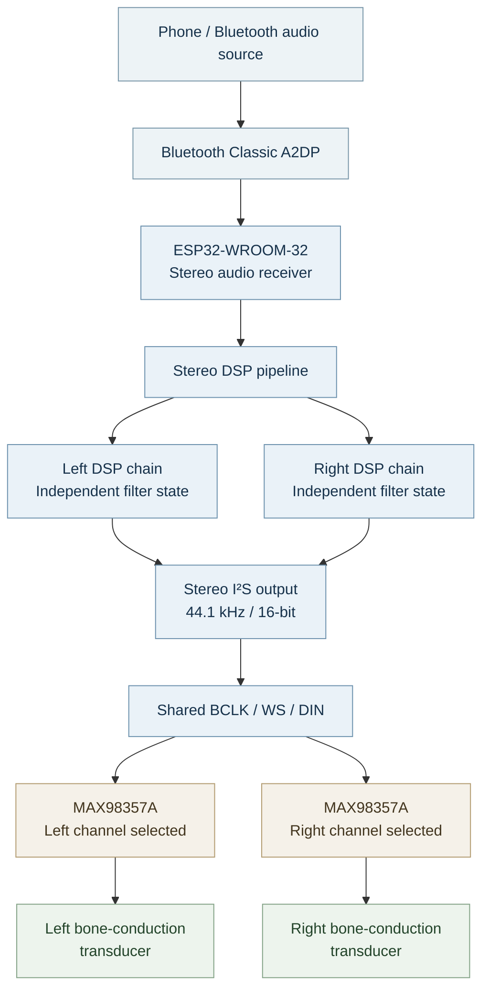
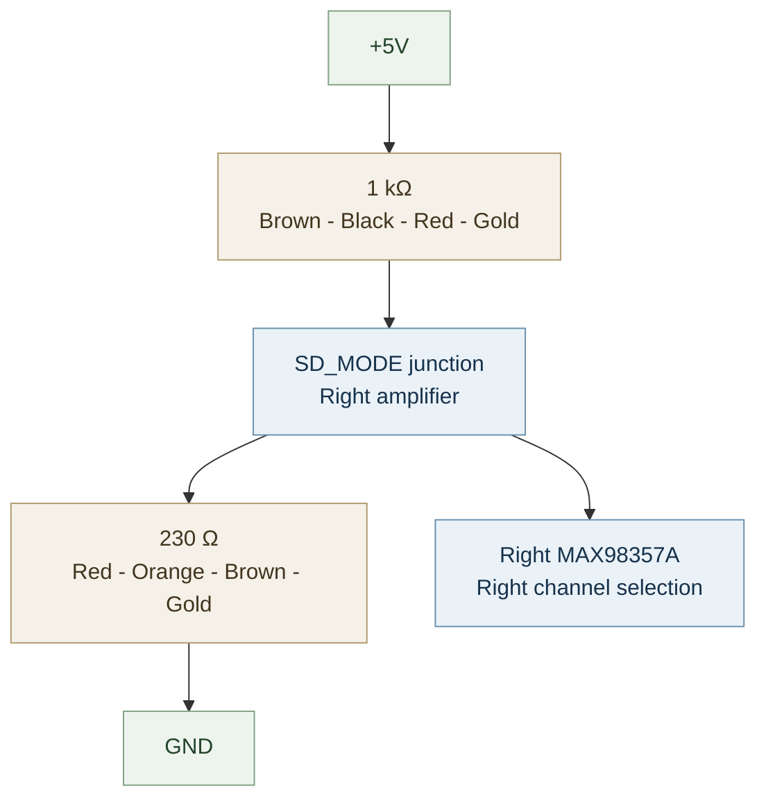
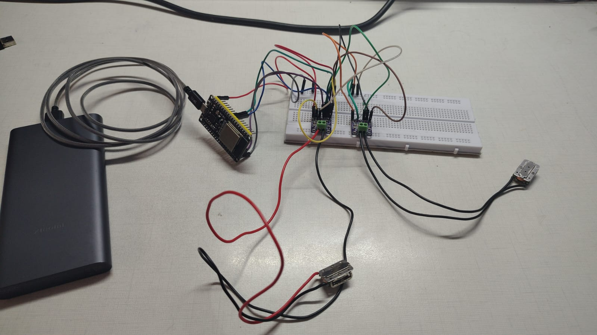

# T03: Independent Stereo Playback

**PASSED.** We verified independent left and right Bluetooth audio playback using an ESP32-WROOM-32, two MAX98357A amplifiers and two bone-conduction transducers.

Each amplifier receives the same I²S clock and data connections but selects a different audio channel through its SD_MODE pin. The left amplifier drives the left BCT, while the right amplifier drives the right BCT.

[Test sketch](T03_independent_stereo.ino) · [Main firmware](../../main/main.ino) · [Bench wiring](../../../../docs/test-setup.md)

## Audio architecture

Bluetooth Classic A2DP delivers two digital audio channels to the ESP32-WROOM-32. The firmware processes each channel independently through its own 32-bit floating-point DSP chain before sending stereo audio over I²S.

Both amplifiers share the digital I²S bus. Channel selection happens inside the individual MAX98357A modules through their SD_MODE configuration.

## DSP configuration

The stereo firmware uses a separate `BoneChannelDSP` instance for each channel. Each instance maintains its own filter state, allowing the left and right signals to be processed independently.

| DSP stage | Configured setting | Purpose |
| --- | --- | --- |
| Pre-gain | -4.5 dB | Creates headroom before EQ boosts |
| High-pass | 180 Hz, Q = 0.7071 | Attenuates low-frequency content |
| Peaking EQ | 2.8 kHz, +4 dB, 0.8-octave bandwidth | Emphasizes the presence region |
| High shelf | 5.5 kHz, +2.5 dB | Adjusts high-frequency balance |
| Output limiter | Soft-knee above 90% full scale | Reduces harsh peak clipping |
| Master volume | 1.0 | Output scaling |

The processing chain uses 32-bit floating-point calculations, followed by a soft-knee limiter and a signed 16-bit output clamp.

### I²S configuration

| Parameter | Value |
| --- | --- |
| Sample rate | 44,100 Hz |
| Bit depth | 16-bit |
| Channels | 2 (Left + Right) |
| BCLK | GPIO 26 |
| WS / LRC | GPIO 25 |
| DIN | GPIO 22 |
| Hardware APLL | Enabled |
| DMA buffer size | 512 |
| DMA buffer count | 10 |

## Hardware connections

Both MAX98357A modules share the same I²S signals and power supply from the ESP32 setup.

### Shared connections

| ESP32 / Power | Left MAX98357A | Right MAX98357A |
| --- | --- | --- |
| GPIO 26 | BCLK | BCLK |
| GPIO 25 | LRC / WS | LRC / WS |
| GPIO 22 | DIN | DIN |
| +5V | VIN | VIN |
| GND | GND | GND |

### SD_MODE channel selection

The SD_MODE pins configure which digital channel each amplifier reproduces.

**Left amplifier:**

Connect SD_MODE directly to +5V to select the left audio channel.

**Right amplifier:**

Our tested setup uses two resistors to create the required channel-selection voltage.

| Resistor | Colour bands | Connection |
| --- | --- | --- |
| 1 kΩ | Brown - Black - Red - Gold | +5V to SD_MODE |
| 230 Ω | Red - Orange - Brown - Gold | SD_MODE to GND |

The common resistor junction connects to the right amplifier's SD_MODE pin. Both resistor connections must share the same circuit ground.

### Transducer connections

| Amplifier | Speaker output | Transducer |
| --- | --- | --- |
| Left MAX98357A | SPK+ and SPK− | Left BCT |
| Right MAX98357A | SPK+ and SPK− | Right BCT |

Each BCT connects across its own amplifier's speaker output. The two amplifiers' speaker outputs remain electrically separate.

## Reproduce the test

1. Connect the ESP32-WROOM-32 and both MAX98357A modules using the connection tables above.
2. Connect one BCT to each amplifier.
3. Verify the shared BCLK, WS, DIN, VIN and GND connections.
4. Check the SD_MODE channel-selection wiring before powering the circuit.
5. Open [T03_independent_stereo.ino](T03_independent_stereo.ino) in Arduino IDE.
6. Select **ESP32 Dev Module** and the correct USB serial port.
7. Verify and upload the firmware.
8. Open Serial Monitor at **115200 baud**.
9. Pair your phone with **BoneBuds Stereo HQ**.
10. Play stereo test audio and verify that each BCT reproduces its assigned channel.

Start at a low playback volume and check the amplifier and transducer temperatures during testing.

## Test results

**T03 independent stereo playback was successfully verified.**

| Verification | Result |
| --- | --- |
| Bluetooth A2DP connection | **PASSED** |
| Left-channel playback | **PASSED** |
| Right-channel playback | **PASSED** |
| Independent left/right output | **PASSED** |
| Two amplifiers operating together | **PASSED** |
| Separate BCT outputs | **PASSED** |

A stereo test audio track was used to verify independent channel playback through the two amplifier and transducer paths.

## Hardware evidence

The following photograph documents the actual T03 stereo bench setup.

*OSSIS T03: Independent stereo playback using two amplifier modules and two bone-conduction transducers.*

## Firmware notes

- [Current main firmware](../../main/main.ino) contains the working T03 stereo implementation.
- This test sketch is retained as the T03 experiment record.
- T03 uses independent left and right DSP processing.
- The T02 wireless OTA functionality has not yet been integrated into the current main firmware.

[Previous test: T02 Wireless OTA](../T02_mono_ota/README.md) · [Test results](../../../../docs/test-results.md#t03-independent-stereo-playback) · [Development log](../../../../docs/development-log.md)
