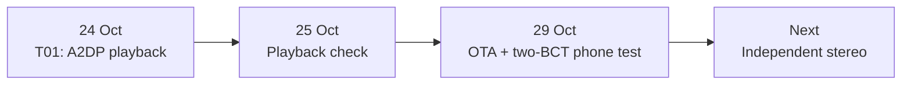

# OSSIS development log

Our bench-test milestones and current findings.

## Bench history

| Date | Work | Result |
| --- | --- | --- |
| Earlier | ESP32-S3 audio experiments | We tried I²S, tones, local playback and microphone loopback. A replacement USB cable fixed connectivity; end-to-end playback remained exploratory. |
| 24 Oct | T01 on ESP32-WROOM-32, MAX98357A and one BCT | A2DP playback worked. Early noise, idle vibration and rapid heating led us to recheck the connections; corrected wiring produced cleaner audio. |
| 25 Oct | Single-BCT listening check | No unwanted idle vibration or noticeable heating during the short check; a slight quality issue remained. |
| 29 Oct | T02 wireless OTA | We uploaded firmware over Wi-Fi and returned to Bluetooth playback. |
| 29 Oct | Phone source, two 8 Ω BCTs in parallel on one MAX98357A | Clear, loud audio without audible noise. Laptop streaming showed slight noise and intermittent breakup, so we chose the phone for repeat tests. |

## Current result

We obtained clear playback at the contact points just in front of the ears while still hearing our surroundings. There was no noticeable leakage at normal listening levels, with only very faint leakage at maximum volume. Maximum volume was unnecessary.

[Playback observations](test-results.md#29-october-shared-amplifier-playback) · [T01 demonstration](https://youtube.com/shorts/Wacn75VJihI) · [T02 demonstration](https://youtu.be/clWIIejxp3k)

## Next

We will test independent left/right output after buying the second amplifier. CAD development continues in parallel.
