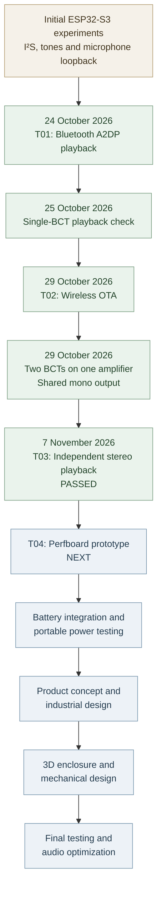
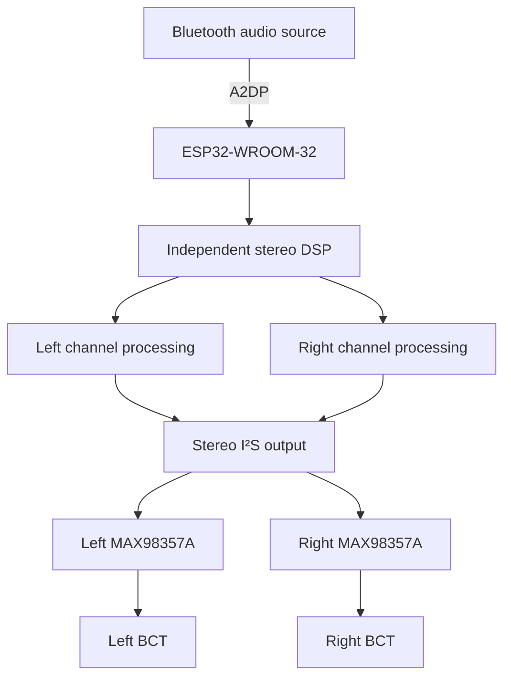
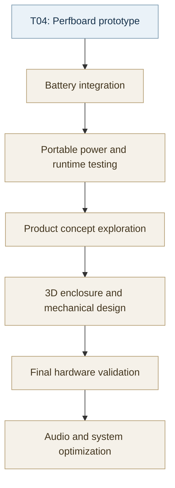

# OSSIS development log

A chronological record of our hardware experiments, firmware milestones and prototype development.

## Development timeline

## Bench history

| Date | Work | Result |
| --- | --- | --- |
| Earlier | ESP32-S3 audio experiments | We explored I²S, tones, local playback and microphone loopback. A replacement USB cable resolved connectivity issues, but end-to-end playback remained exploratory. |
| 24 October 2026 | T01: ESP32-WROOM-32, MAX98357A and one BCT | Bluetooth A2DP playback worked. Initial noise, idle vibration and heating led us to inspect the connections. Corrected wiring produced cleaner playback. |
| 25 October 2026 | Single-BCT listening check | No unwanted idle vibration or noticeable heating during the short check. A slight audio quality issue remained. |
| 29 October 2026 | T02: Wireless OTA | Successfully uploaded firmware over Wi-Fi and returned to Bluetooth playback. |
| 29 October 2026 | Two 8 Ω BCTs on one MAX98357A | Clear and loud phone playback using two BCTs connected in parallel. Laptop streaming showed slight noise and intermittent breakup. |
| Subsequent stereo testing | T03: Independent stereo playback | Successfully tested two MAX98357A amplifiers with separate BCT outputs and independent left/right audio channels. |

## T01: Bluetooth playback baseline

Our first verified ESP32-WROOM-32 implementation established Bluetooth Classic A2DP playback through the MAX98357A.

The initial setup exposed issues with noise, idle vibration and heating. We rechecked the physical connections and refined the audio processing configuration.

We retained the original single-amplifier firmware as the T01 reference.

[T01 test sketch](../code/ossis/tests/T01_wroom_bt_a2dp/T01_wroom_bt_a2dp.ino) · [T01 test procedure](../code/ossis/tests/T01_wroom_bt_a2dp/README.md) · [Playback demonstration](https://youtube.com/shorts/Wacn75VJihI)

## T02: Wireless OTA

We implemented wireless firmware updates using ArduinoOTA over Wi-Fi.

Bluetooth playback and OTA operate in separate firmware modes. The ESP32 saves its operating mode using Preferences and restarts when switching between them.

The update procedure allows firmware uploads through Arduino IDE without a USB data connection after the initial installation.

[ T02 test sketch](../code/ossis/tests/T02_mono_ota/T02_mono_ota.ino) · [OTA procedure](../code/ossis/tests/T02_mono_ota/README.md) · [OTA demonstration](https://youtu.be/clWIIejxp3k)

## 29 October: Shared-amplifier playback

We tested two Adafruit 8 Ω, 1 W bone-conduction transducers connected in parallel to one MAX98357A amplifier.

A phone was used as the reference Bluetooth audio source.

| Observation | Result |
| --- | --- |
| Audio playback | Clear and loud |
| Transducer contact position | Just in front of each ear |
| Ambient awareness | Surrounding sounds remained audible |
| Sound leakage | No noticeable leakage at normal volume |
| Maximum volume | Not required |
| Laptop streaming | Slight noise and intermittent breakup |

This configuration demonstrated that one amplifier could drive both transducers through a shared mono output.

It was an intermediate hardware milestone, not the final stereo configuration.

## T03: Independent stereo playback

**PASSED.** We successfully implemented and tested independent left and right audio output using two MAX98357A amplifier modules.

### Hardware configuration

| Component | Quantity |
| --- | ---: |
| ESP32-WROOM-32 | 1 |
| MAX98357A | 2 |
| 8 Ω bone-conduction transducers | 2 |

Both amplifier modules receive the same I²S clock and data connections from the ESP32. Their SD_MODE pins are configured differently to select separate left and right audio channels.

Each amplifier drives its own BCT.

### Stereo signal path

### Firmware improvements

The current stereo implementation introduces:

- Independent left and right DSP instances.
- A single-pass 32-bit floating-point processing chain per channel.
- Pre-gain headroom before EQ boosts.
- A soft-knee output limiter and signed 16-bit safety clamp.
- Corrected RBJ biquad coefficient calculations for the peaking and high-shelf filters.
- ESP32 hardware APLL requested for I²S clock generation.

The configured audio format is 44.1 kHz, 16-bit stereo.

### Verification

| Check | Result |
| --- | --- |
| Bluetooth A2DP connection | **PASSED** |
| Left-only audio playback | **PASSED** |
| Right-only audio playback | **PASSED** |
| Independent stereo output | **PASSED** |
| Both amplifiers operating together | **PASSED** |
| Separate BCT outputs | **PASSED** |

The two channels were verified independently using stereo test audio.

**Hardware evidence:** [T03 stereo test photograph](../images/tests/T03/t03-stereo-hardware-setup.jpg)

[T03 firmware](../code/ossis/main/main.ino) · [T03 test procedure](../code/ossis/tests/T03_independent_stereo/README.md) · [Complete test results](test-results.md#t03-independent-stereo-playback)

> [!NOTE]
> T03 is now the current main firmware. The T02 wireless OTA implementation remains preserved separately and has not yet been integrated into the stereo firmware.

## Current prototype

OSSIS currently has a working Bluetooth stereo bench prototype using an ESP32-WROOM-32, two MAX98357A amplifiers and two bone-conduction transducers.

The next objective is to move beyond temporary breadboard wiring and develop a more compact, portable and mechanically suitable prototype.

## Next development stages

| Stage | Work | Objective | Status |
| --- | --- | --- | --- |
| T04 | Perfboard prototype | Move from breadboard wiring to a more stable assembly | **NEXT** |
| T04 | Battery integration | Develop battery-powered operation and test runtime | PLANNED |
| T05 | Product concept | Explore the physical form, wearable arrangement and design direction | PLANNED |
| T06 | 3D design | Develop the enclosure and mechanical assembly | PLANNED |
| T07 | Final validation | Test audio quality, reliability, power consumption and thermal behaviour | PLANNED |
| T07 | Optimization | Refine the hardware, firmware and overall listening experience | PLANNED |

## Documentation and references

- [Test results](test-results.md)
- [Bench setup and connections](test-setup.md)
- [Firmware guide](../code/README.md)
- [T01: Bluetooth playback](../code/ossis/tests/T01_wroom_bt_a2dp/README.md)
- [T02: Wireless OTA](../code/ossis/tests/T02_mono_ota/README.md)
- [T03: Independent stereo](../code/ossis/tests/T03_independent_stereo/README.md)
- [Documentation index](README.md)
